# MasterNodes for After Effects — downloads

Node-based graphics, particles, smoke & fire and compositing inside Adobe After Effects.

Apply **Effect > MasterNodes > MasterNodes** to a layer and click **Edit Graph…**. A node editor opens, and the graph renders
straight into your comp: no pre-renders, no extra layers. The graph is saved with the effect, so it travels with duplicates,
copy / paste and effect presets, and any value you expose becomes a keyframeable control in Effect Controls.

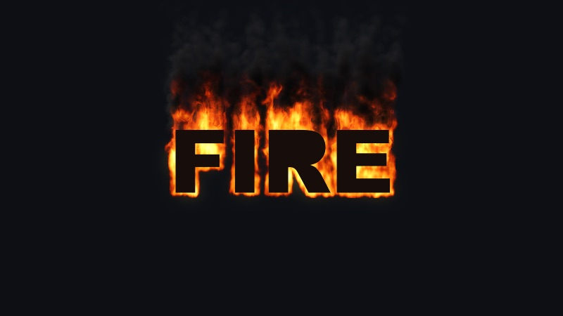 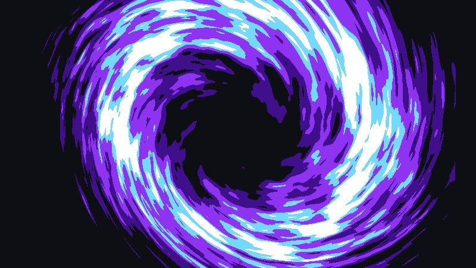 

## Download

Get the latest installer from **[Releases](https://github.com/XavierChuu/MasterNodes-Releases/releases)**.

| System | File |
| --- | --- |
| Windows 10/11 (64-bit) | `MasterNodes-<version>-win.exe` |
| macOS 11 or newer (Apple silicon and Intel) | `MasterNodes-<version>-mac.pkg` |

Requires After Effects 2024 or newer.

## What it does

- **Procedural graphics in 3D.** Points, curves, meshes and instances, all in 3D, seen through the comp camera. Shapes,
  text (String to Curves, or the outlines of your AE text layers), trees, org charts and mind maps.
- **Particles.** Emitters, forces (gravity, wind, turbulence, vortex, attract, bounce), trails, in 2D or 3D, emitting from
  shapes, meshes or your layers.
- **Volumetric fire & smoke.** Campfires, explosions, smoke columns, burning titles, layers that burn away or evaporate.
- **Fluid simulation.** A real smoke / fire solver on a 3D grid with buoyancy, vorticity and wind. It simulates while you play;
  **Bake** saves the frames to disk so renders only read them back.
- **Motion design.** Ease and Animate nodes, staggered grids, loaders, draw-on lines, kinetic type, number counters.
- **Compositing.** Blender-style image nodes: color correction, blurs, glare, keying, lens effects, Cryptomatte, AOV and
  depth passes, light groups.
- **Bring in After Effects.** Use layers, masks, tracking data, the comp camera and audio as inputs, or run a native
  AE effect inside the graph (AE Effect node, test version).
- **Built for speed.** Renders on the GPU (Direct3D / CUDA on Windows, Metal on Mac), supports Multi-Frame Rendering and
  8 / 16 / 32-bit color.
- **Ask Claude.** Describe what you want and Claude builds or edits the graph for you (uses your own Anthropic API key).

## Nodes

186 nodes. Press **Shift+A** or right-click in the editor to add one:

| Group | Nodes | Examples |
| --- | ---: | --- |
| Input | 14 | Time, Value, Color, Layer, Layer Info, Layer Track, Mask Path, Camera, Audio Spectrum |
| Geometry | 46 | Grid / Random Points, Circle, Star, Spiral, Lightning, Cube, UV Sphere, Instance on Points, Curve Boolean, Offset Path, Fill, Stroke, String to Curves, Plant, Tree Chart |
| Fields & utilities | 41 | Position, Index, Random Value, Math, Vector Math, Map Range, Ease, Animate, Color Ramp, Switch, Compare, Capture Attribute, Simulation Zone, Repeat Zone |
| Textures | 14 | Noise, Voronoi, Wave, Checker, Brick, Magic, Gabor, Turbulent Noise, 4-Color Gradient |
| Particles | 5 | Particle Emitter, Particle Force, Particle Simulation, Particle Draw, Particle Trails |
| Effects | 7 | Flames, Smoke, Dissolve, Noise Volume, Turbulent Warp, Distance Field, Laser Beam |
| Simulation | 3 | Fluid Simulation, Volume Load, Volume Render |
| Compositing | 51 | Curves, Levels, Color Balance, Tonemap, Blur, Bokeh Blur, Defocus, Glare, Chroma Key, Cryptomatte, Depth Matte, Lens Distortion, Chromatic Aberration, Film Grain, Corner Pin |
| After Effects | 1 | AE Effect |
| Layout | 4 | Note, Frame, Node Group, Group Output |

## Presets

More than 150 ready-to-use graphs in 24 categories, plus 11 node groups to drop into your own graphs. Open them from the editor
menu: **Presets…**.

Basics · Motion · Motion Graphics · Text & Shapes · 3D · Backgrounds · Textures · Points & Instances · Particles ·
3D Particles · Confetti · Holidays · Dissolve · Magic · Fire & Smoke · Fluid Simulation · Lasers · Audio · Interaction ·
Waves · 2D FX in 3D · Diagrams & Plants · Compositing · Zones & New Nodes

<table>
<tr>
<td width="33%"> <b>Burning Title 3D</b> · Fire & Smoke</td>
<td width="33%">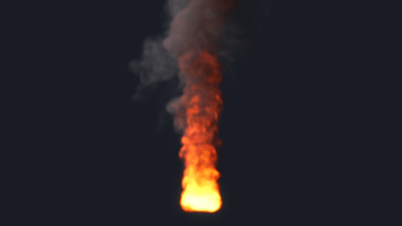 <b>Bonfire (Simulation)</b> · Fluid Simulation</td>
<td width="33%">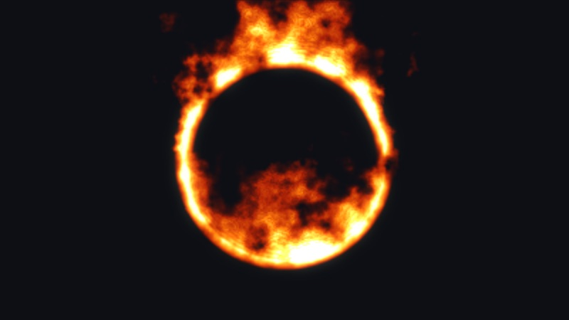 <b>Ring of Fire</b> · Fire & Smoke</td>
</tr>
<tr>
<td>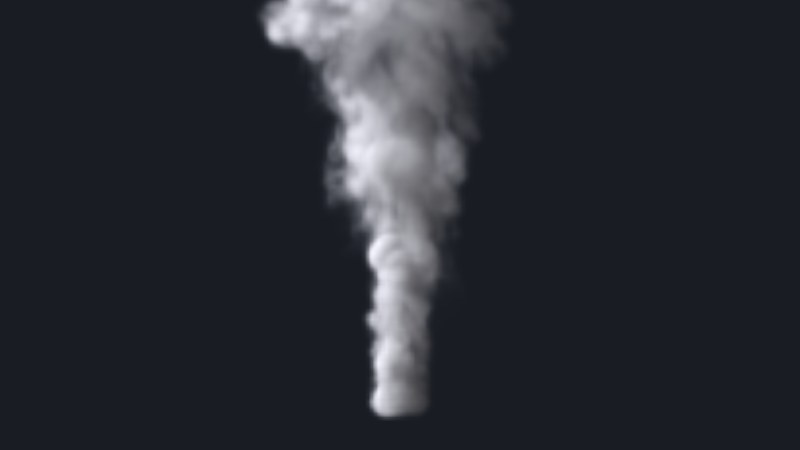 <b>Smoke Plume (Simulation)</b> · Fluid Simulation</td>
<td>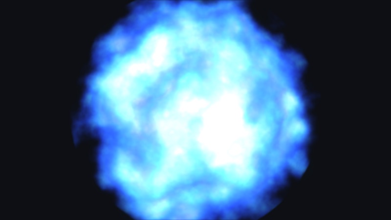 <b>Energy Orb</b> · Fire & Smoke</td>
<td>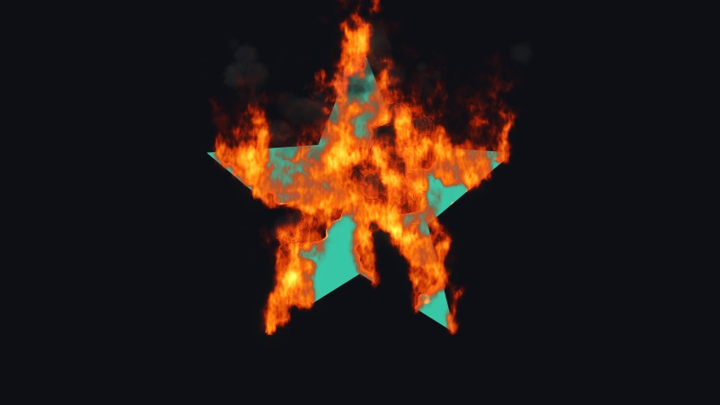 <b>Burn Away Layer</b> · Fire & Smoke</td>
</tr>
<tr>
<td> <b>Magic Portal</b> · 2D FX in 3D</td>
<td>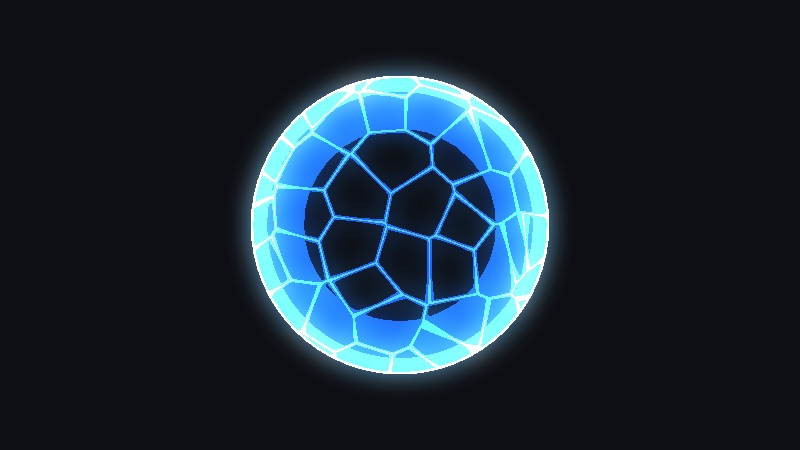 <b>Energy Shield</b> · 2D FX in 3D</td>
<td>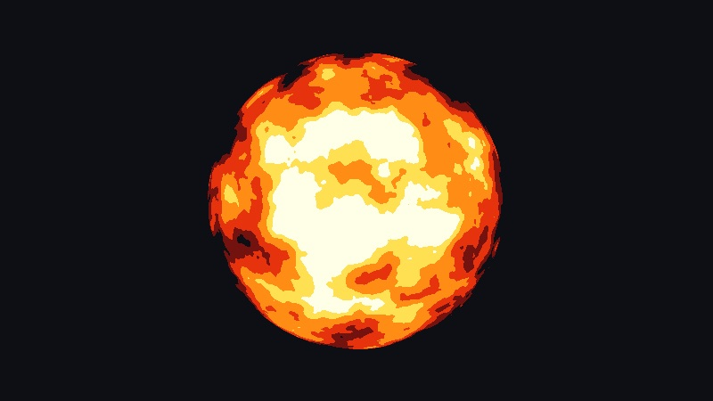 <b>2D Explosion Ball</b> · 2D FX in 3D</td>
</tr>
<tr>
<td>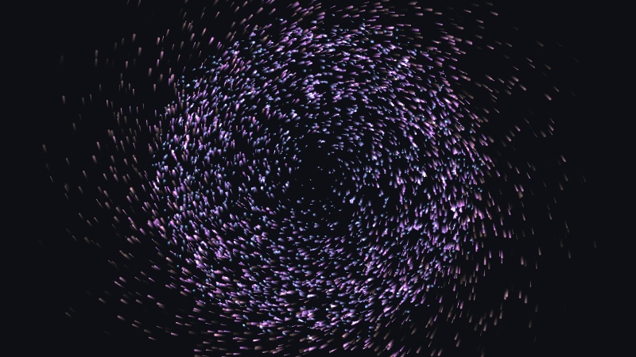 <b>Galaxy Swirl</b> · Particles</td>
<td>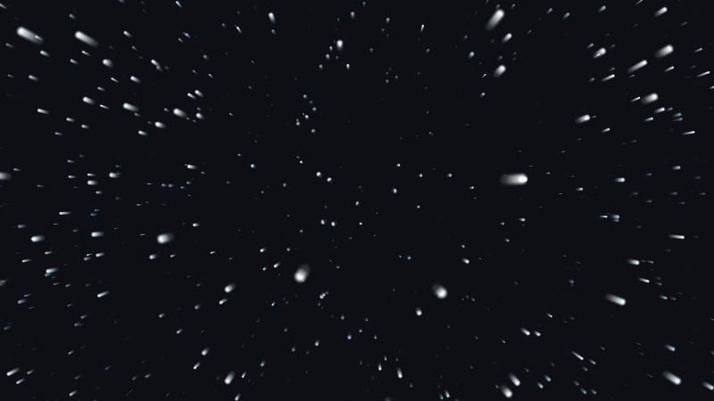 <b>Star Tunnel</b> · 3D Particles</td>
<td> <b>Neon Double Helix Tree</b> · Holidays</td>
</tr>
<tr>
<td>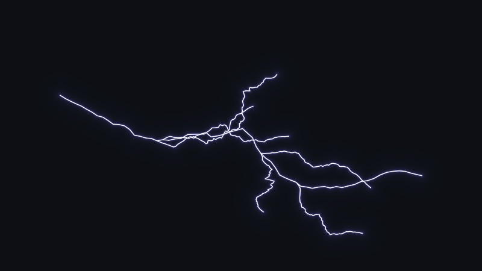 <b>Lightning Arc</b> · Lasers</td>
<td>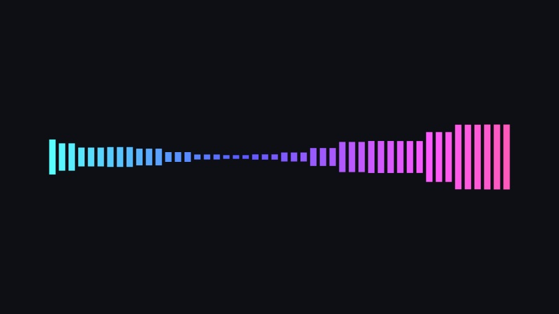 <b>Equalizer Bars</b> · Audio</td>
<td>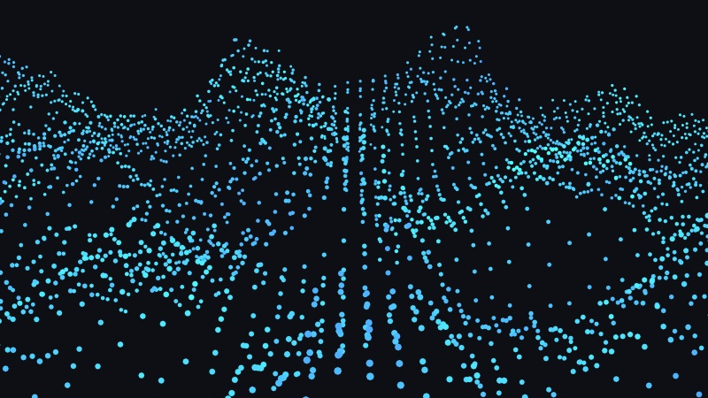 <b>Point Ocean</b> · Waves</td>
</tr>
<tr>
<td> <b>Staggered Title Rise</b> · Motion Graphics</td>
<td> <b>Quarter Turn Tiles</b> · Motion Graphics</td>
<td> <b>Rising Blocks</b> · Motion Graphics</td>
</tr>
<tr>
<td>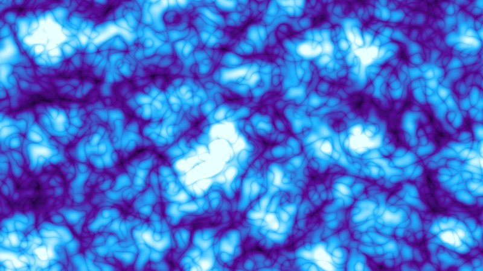 <b>Turbulent Plasma</b> · Backgrounds</td>
<td>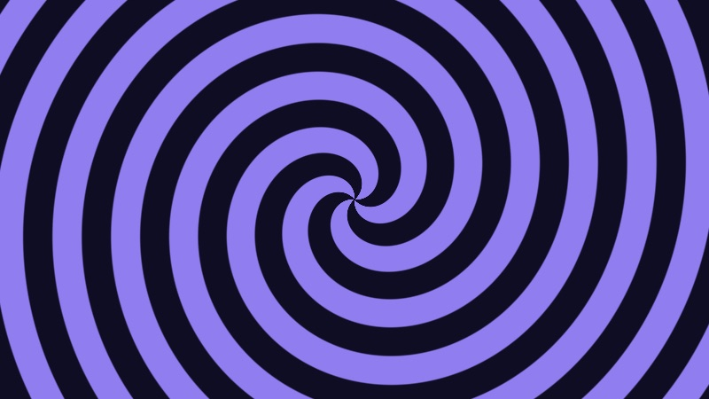 <b>Hypno Spiral</b> · Backgrounds</td>
<td>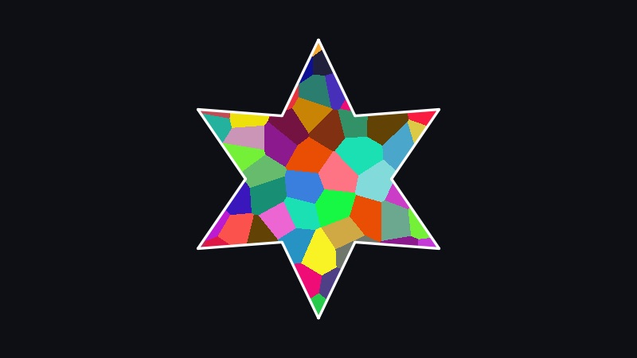 <b>Stained Glass Star</b> · Textures</td>
</tr>
<tr>
<td> <b>Blossom Branch</b> · Diagrams & Plants</td>
<td>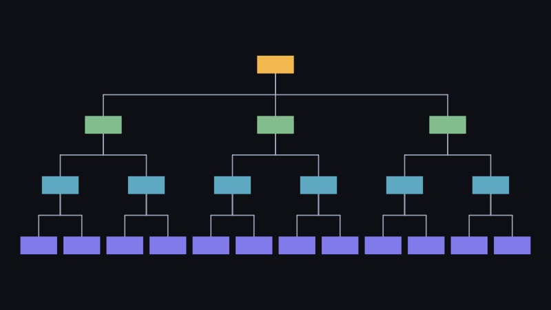 <b>Organization Chart</b> · Diagrams & Plants</td>
<td>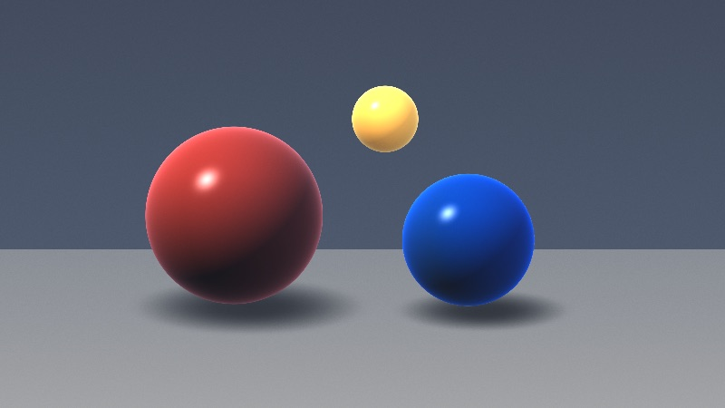 <b>3D Comp Starter</b> · Compositing</td>
</tr>
</table>

Single frames rendered by MasterNodes from the built-in presets. In After Effects they animate.

## Install (Windows)

1. Save your work and quit After Effects, Premiere Pro and Media Encoder.
2. Run `MasterNodes-<version>-win.exe` and click **Yes** when Windows asks for administrator permission.
3. Start After Effects, select a layer and choose **Effect > MasterNodes > MasterNodes**, then click **Edit Graph…**.

To update, run the new installer the same way: your projects, presets and settings are kept.
To uninstall: Windows **Settings > Apps > Installed apps > MasterNodes for After Effects**.

## Install (macOS)

1. Save your work and quit After Effects, Premiere Pro and Media Encoder.
2. Open `MasterNodes-<version>-mac.pkg` and follow the installer; enter your Mac password when asked.
   If macOS says the developer cannot be verified: right-click the file > **Open** > **Open**
   (or **System Settings > Privacy & Security > Open Anyway**).
3. Start After Effects, select a layer and choose **Effect > MasterNodes > MasterNodes**, then click **Edit Graph…**.

To update, open the new installer the same way: your projects, presets and settings are kept.
To uninstall: open **/Library/Application Support/MasterNodes** in Finder and double-click **Uninstall MasterNodes.command**.

## Updates

The MasterNodes editor checks this repository's [`latest.json`](latest.json) at most twice a day and shows a
notice when a newer version is out. It only downloads that file and sends no information about your computer.
Turn it off in the editor menu: **Check for updates automatically**.

## Feedback

Editor menu > **About & Feedback…**, or open an [issue](https://github.com/XavierChuu/MasterNodes-Releases/issues).
